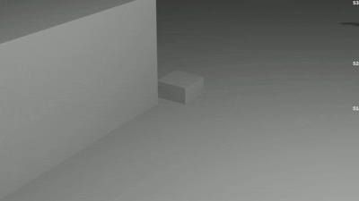
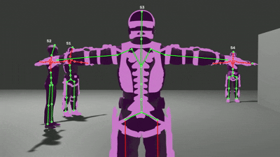
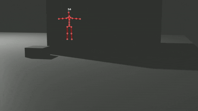

# BlendMimic3D-DataExtractor: Blender Data Extraction Tool

## Overview

The BlendMimic3D-DataExtractor is designed to convert .fbx files to .npy format, specifically for human motion analysis. It was instrumental in generating [BlendMimic3D](https://github.com/FilipaLino/BlendMimic3D) dataset from our project. For more detailed information about to our project please visit our [project webpage](https://blendmimic3d.github.io/BlendMimic3D/).

This repository contains scripts that require Blender to run.
<p align="left">
  
</p>


Blender can be downloaded from the [official website](https://www.blender.org/download/).

## Dependencies
- Blender
- Python

### Reference Environment
- Blender 5.1.2
- WSL Ubuntu Bash and Linux Python with NumPy, PyYAML, and OpenCV
- Windows `blender.exe` launched from WSL; Blender uses its bundled Python.
- The controller environment is specified in `environment.yml`.

## Contents

### Annotation Parts
- `run.sh`: Sequential Scene, Action, and animated FBX batch controller.
- `generate_dataset.py`: Single-sample controller with isolated Run workspace.
- `run_annotations.sh`: Ordered 3D, camera, 2D, and occlusion extraction.
- `ActionDetect.py`: Blender helper script to inspect armatures and animations within a `.blend` scene file.
- `3D_extraction.py`: Converts .fbx files to .npz files containing 3D joint data.
- `camParams.py`: Extracts camera parameters used in the animations.
- `2D_extraction.py`: Extracts 2D joint data by projecting the 3D joint data onto 2D space using camera parameters.
- `occlusion.py`: Determines the presence of occlusions in the dataset.
- `fbx2jason/`: Intended for storing .fbx files converted to JSON.
- `regular/`: Historical input directory for the direct legacy workflow.

### Visualized Parts
- `run_visualize.sh`: Unified pipeline script to batch `render camera frames` and `generate skeletal visualization videos`.
- `export_image.py`: Blender background rendering script to export multi-camera frame sequences.
   > Also, you can render your image with your Blender interface.
- `visualize_2d_video_v3.py`: OpenCV script to generate visualized video from specific render image folder.
features:
   - overlay projected 2D skeletons
   - joint visibility indicators (with occlusion distinction)
   - subject tags on rendered frames.
- `images/`: Default staging directory for rendered camera frames

## Setup
1. Clone or download this repository to your local machine.
2. Create the WSL controller environment from `environment.yml` and configure
   the Linux path to `blender.exe` in `configs/examples/generation_example.yaml`.

### Directory Structure
Each Run keeps legacy intermediate outputs separate from the final canonical
sample. The working .blend sits two levels below that Run work directory.

```text
runs/RUN_.../
|-- work/
|   |-- preprocessing/BlendMimic3D-DataExtractor/working_scene.blend
|   +-- BlendMimic3D/Pxxx/
|-- config.yaml
|-- scene_report.json
+-- validation.json
output.root/SxxxPxxxRxxxAxxx/
```

## Quick Start in WSL

Run from the repository root. Scene and Action YAML files choose the clean
template, validated FBX directory, and scene-specific placement. The example
uses Linux `/mnt/c/...` paths; only arguments sent to Windows Blender are
converted with `wslpath`.

```bash
conda env create -f environment.yml
conda activate blendmimic3d-controller
python generate_dataset.py --config configs/examples/generation_example.yaml --dry-run
python generate_dataset.py --config configs/examples/generation_example.yaml
```

For a sequential batch, select one or more Scene and Action configs. Use
`--dry-run` first, then remove it to generate. Each valid `PxxxAxxxRxxx.fbx`
is passed to the single-sample generator once per selected Scene. Batch results
are logged under `runs/BATCH_*/`; complete samples are published under the
configured `output.root` only after validation.

```bash
bash run.sh \
  --config configs/examples/generation_example.yaml \
  --scene-config configs/scenes/S001_Industrial_Loft.yaml \
  --action-config configs/actions/A001_walking.yaml \
  --python "$(command -v python)" \
  --dry-run
```

The generator stores one `runs/RUN_*/work/` workspace per sample. Windows
Blender and WSL Bash resolve the legacy `../../BlendMimic3D/Pxxx/` output to
the same Run workspace. `run_visualize.sh` uses WSL Python for OpenCV overlays.

Below are samples of the extracted 2D pose overlays and occlusion indicators across multiple camera viewpoints:

| Cam_0 (Perspective Front) | Cam_1 (Perspective Side) | Cam_2 (Perspective Side) |
| :---: | :---: | :---: |
|  |  |  |
| *Green: Visible / Red: Occluded* | *Green: Visible / Red: Occluded* | *Green: Visible / Red: Occluded* |

## Legacy Manual Script Reference

The examples below describe direct research-script invocation outside the
current config-driven pipeline.

### General Usage
Before running the scripts, download a sample .fbx file from your Blender animation ([link](https://www.immersivelimit.com/tutorials/export-animations-from-blender-to-unreal-engine)) and place it into the `regular` folder.

### 3D Data Extraction
1. Move the .fbx file to the `regular` folder.
2. Open a command prompt with administrator permissions.
3. Change to the directory containing `3D_extraction.py`.
4. Execute the script with the following command:
   ```
   blender --background -P 3D_extraction.py -- --joint-id "" --armature-name Armature --subject S1 --action <action_name>
   ```

### Camera Parameters Extraction
1. Change to the directory containing `camParams.py`.
2. Execute the script with the following command:
   ```
   blender --background animation.blend --python camParams.py -- S1
   ```

### 2D Data Conversion
1. Change to the directory containing `2D_extraction.py`.
2. Execute the script with the following command:
   ```
   blender --background animation.blend --python 2D_extraction.py -- S1 <action_name>
   ```

### Occlusion Handling
1. Change to the directory containing `occlusion.py`.
2. Execute the script with the following command:
   ```
   blender --background animation.blend --python occlusion.py -- --joint-id "" --armature-name Armature --subject S1 --action <action_name>
   ```

### Multi-Camera Image Rendering
1. Change to the directory containing `export_image.py`.
2. Execute the script with the following command:
   ```bash
   # fisheye cannot support EEVEE engine, you should change to CYCLE
   blender --background animation.blend --python export_image.py -- ./images/S1 EEVEE
   ```

### Video with Skeleton Annotation
1. Change to the directory containing `visualize_2d_video.py`.
2. Execute the script with the following command:
   ```bash
   python visualize_2d_video_v3.py \
   --scene_dir ../../BlendMimic3D/S1 \
   --cam Cam_0 \
   --img_folder images/S1/Cam_0 \
   --output Cam_0_viz.avi \
   --subject
   ```

## Contributing
Contributions are welcome. Please open an issue or submit a pull request with your suggested changes.

## Citation
If you use our code in your research, please cite our paper:
```
@inproceedings{lino20243d,
  title={3D Human Pose Estimation with Occlusions: Introducing BlendMimic3D Dataset and GCN Refinement},
  author={Lino, Filipa and Santiago, Carlos and Marques, Manuel},
  booktitle={Proceedings of the IEEE/CVF Conference on Computer Vision and Pattern Recognition},
  pages={4646--4656},
  year={2024}
}
```

## Aknowledgements
This work was supported by LARSyS funding (DOI: 10.54499/LA/P/0083/2020, 10.54499/UIDP/50009/2020, and 10.54499/UIDB/50009/2020) and 10.54499/2022.07849.CEECIND/CP1713/CT0001, through Fundação para a Ciência e a Tecnologia, and by the SmartRetail project [PRR - C645440011-00000062], through IAPMEI - Agência para a Competitividade e Inovação.
<p align="center">
  
</p>
